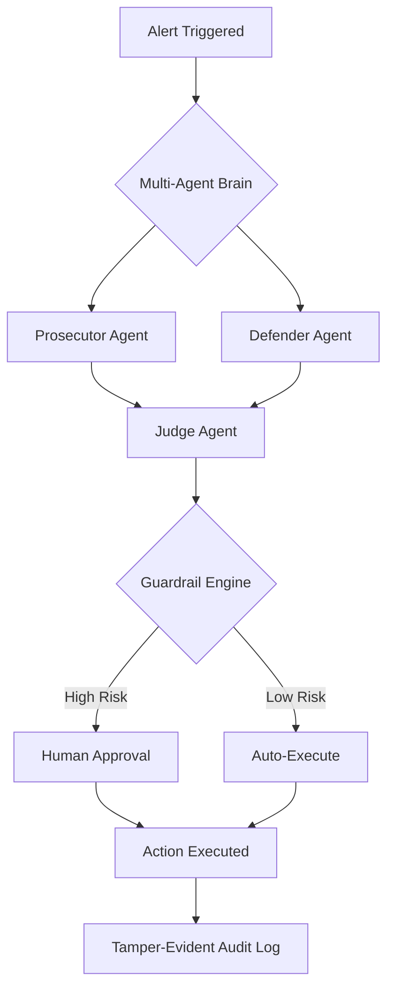

# Aegis_core

🏦 **Autonomous Multi-Agent Fraud Detection System**

An enterprise-grade AI security orchestrator that uses **Adversarial Multi-Agent Debate** to investigate financial fraud, money laundering (AML), and cyber-attacks. Unlike traditional rule-based systems, this agent employs a "Prosecutor–Defender–Judge" framework to reduce hallucinations and bias, while maintaining strict regulatory compliance through deterministic guardrails.

> ⚠️ **Status: Proof of Concept.** The current version simulates agent reasoning and uses mock banking backends. It is not production-ready for real banking environments — see the Security Notes section.

## 🚀 Key Features

- ⚖️ **Adversarial Debate Framework:** Three specialized AI agents (Prosecutor, Defender, Judge) cross-examine transaction data before any decision, improving accuracy and explainability.
- 🛡️ **Deterministic Guardrails:** Human-in-the-loop safety layer — the AI proposes actions, but high-risk operations (like freezing accounts) require explicit human approval.
- 🔒 **Tamper-Evident Audit Logging:** Hash-chained (SHA-256) audit trail recording every decision and API call, ensuring forensic accountability for regulators.
- 🕵️ **PII Redaction & Compliance:** Automated masking engine redacts sensitive customer information (account numbers, IDs) before logging, supporting GDPR/CCPA alignment.
- 🌐 **Provider-Agnostic Architecture:** Integrates with Groq, OpenAI, Azure, Anthropic, or private banking LLMs via secure environment variable management.

## 🏗️ Architecture



## 🛠️ Tech Stack

- **Language:** Python 3.10+
- **AI Orchestration:** Groq API / OpenAI SDK
- **Data Validation:** Pydantic (strict schema enforcement)
- **Security:** hashlib (SHA-256), getpass, re (PII masking)
- **Database:** SQLite (mock banking core)

## 📂 Project Structure

```
bank-security-agent/
├── bank_agent.py       # Main orchestration logic
├── .env.example        # Template for API keys
├── requirements.txt    # Dependencies
└── README.md           # Project documentation
```

## ⚙️ Installation & Setup

1. **Clone the repository:**

   ```bash
   git clone https://github.com/yourusername/bank-security-agent.git
   cd bank-security-agent
   ```

2. **Install dependencies:**

   ```bash
   pip install -r requirements.txt
   ```

3. **Configure API keys** — set an environment variable or enter the key securely when prompted:

   ```bash
   # Option 1: Environment variable (recommended for production)
   export GROQ_API_KEY="your_api_key_here"

   # Option 2: Interactive input — the script prompts securely if no env var is found
   ```

4. **Run the agent:**

   ```bash
   python bank_agent.py
   ```

## 🧪 Demo Scenarios

The agent comes pre-loaded with mock data to demonstrate its capabilities:

**Scenario 1 — Money Laundering Detection**
- **Input:** $15,000 transfer from `ACC_SUSPICIOUS` to `0xMixerWallet`
- **Process:** Prosecutor flags the mixer wallet; Defender finds no mitigating factors
- **Verdict:** `FRAUD` → account freeze proposed (requires human approval)

**Scenario 2 — Ambiguous Transaction**
- **Input:** $500 transfer to ACME Corp Payroll from internal IP
- **Process:** Prosecutor flags the amount; Defender identifies it as known payroll
- **Verdict:** `LEGIT` → no action taken

## 🔐 Security & Compliance

- **Zero-Trust Data Handling:** All inputs are sanitized; sensitive data is masked via regex before being written to logs.
- **Immutable Logs:** Each log entry contains the hash of the previous entry, creating a chain that makes tampering immediately detectable.
- **Schema Validation:** Pydantic models prevent the AI from generating malformed or dangerous commands.

## 📄 License

This project is licensed under the MIT License — see the LICENSE file for details.
